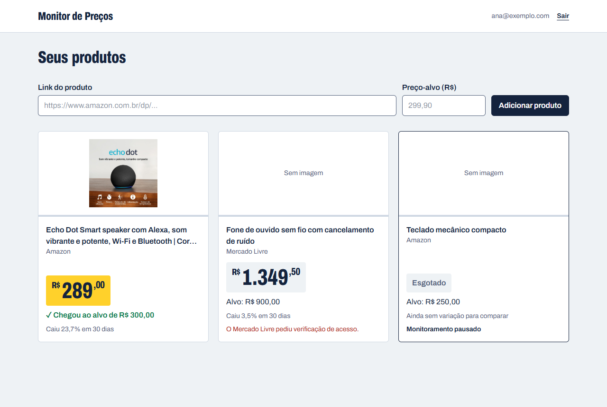
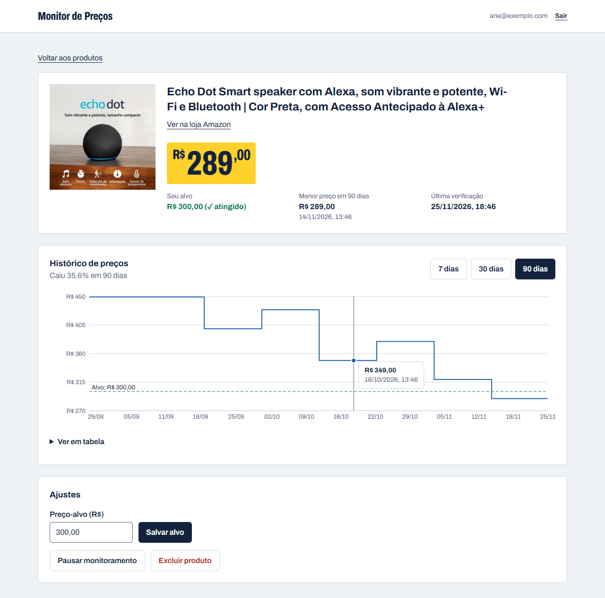
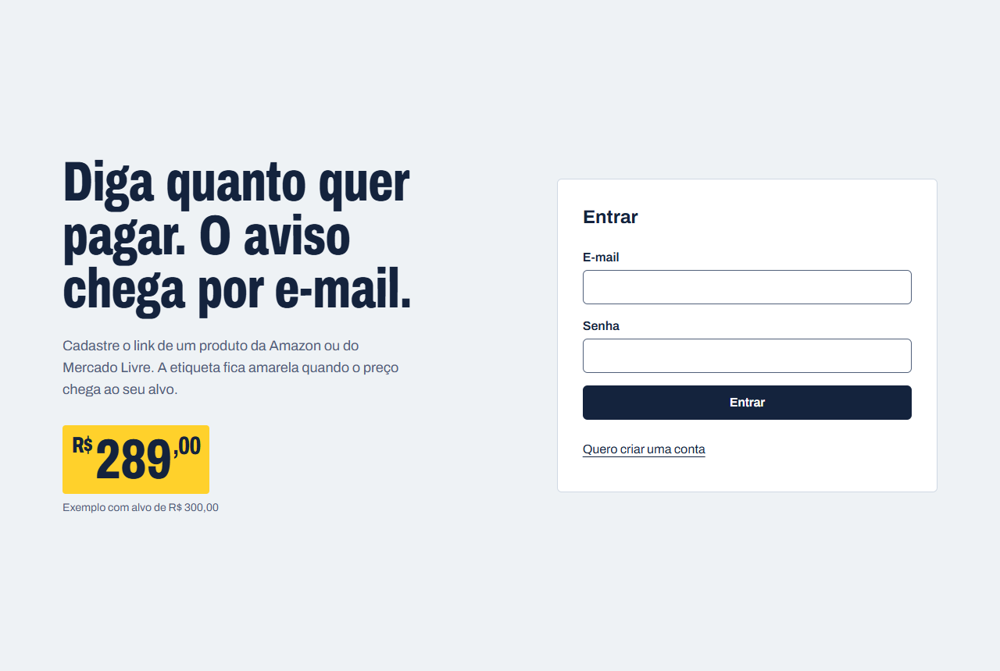
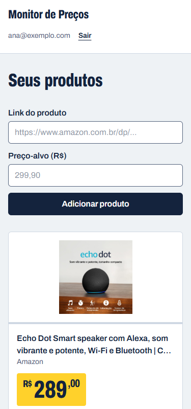
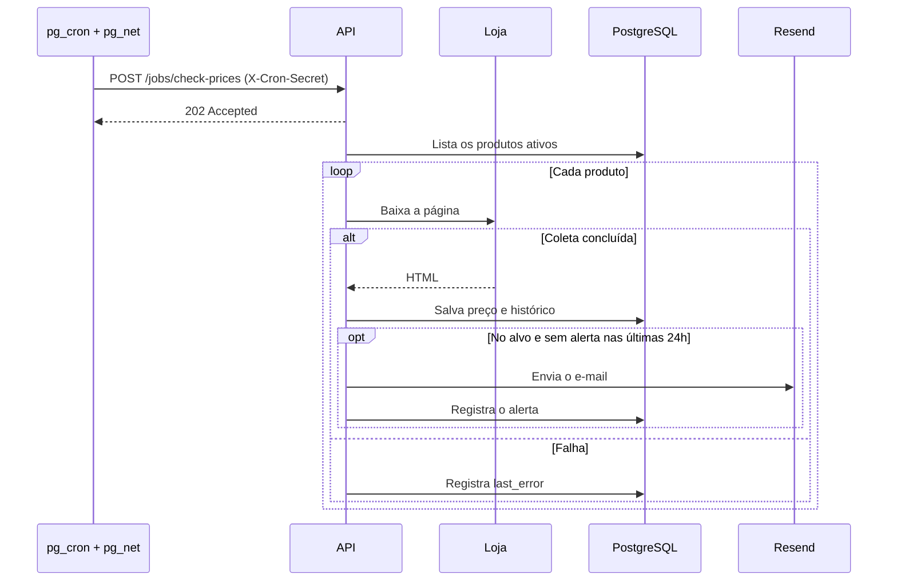
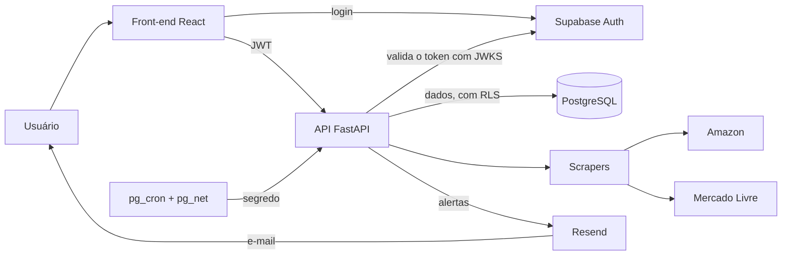
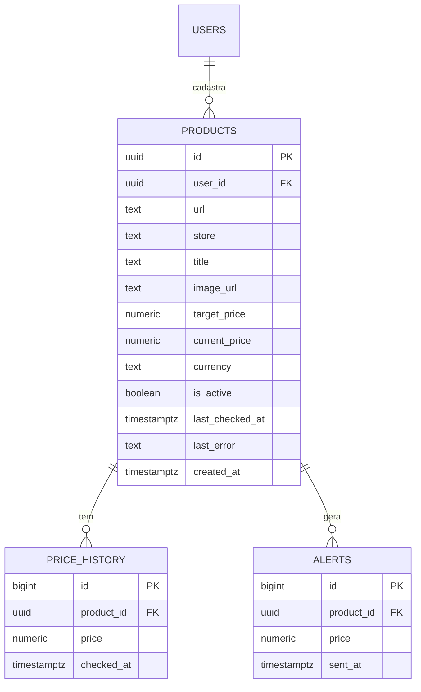

# Monitor de Preços com Alertas por E-mail

Cadastre o link de um produto, diga quanto quer pagar e receba um e-mail quando o preço chegar
lá. O sistema verifica os preços periodicamente e guarda o histórico.



**Stack:** Python, FastAPI, Supabase (PostgreSQL e Auth), Resend, React, TypeScript, Tailwind CSS
e Recharts.

## Sumário

- [Funcionalidades](#funcionalidades)
- [Telas](#telas)
- [Como funciona](#como-funciona)
- [Arquitetura](#arquitetura)
- [Ferramentas](#ferramentas)
- [Decisões técnicas](#decisões-técnicas)
- [Como rodar](#como-rodar)
- [Variáveis de ambiente](#variáveis-de-ambiente)
- [API](#api)
- [Testes e qualidade](#testes-e-qualidade)
- [Limitações](#limitações)
- [Próximos passos](#próximos-passos)
- [Como adicionar uma loja](#como-adicionar-uma-loja)
- [Licença](#licença)

## Funcionalidades

- Cadastro e login por e-mail e senha.
- Cadastro de produtos por link, com a primeira coleta de preço na hora.
- Gráfico do histórico em 7, 30 ou 90 dias e menor preço dos últimos 90 dias.
- E-mail quando o preço fica igual ou abaixo do alvo, com intervalo mínimo de 24 horas por produto.
- Alteração do preço-alvo, pausa e exclusão do monitoramento.
- Layout adaptado a celular e computador.

Lojas: **Amazon Brasil** e **Mercado Livre** (veja as [limitações](#limitações)).

## Telas

As imagens usam dados de demonstração.

| Página do produto | E-mail de alerta |
|---|---|
|  |  |

| Entrada | Celular |
|---|---|
|  |  |

A interface é inspirada nas etiquetas de prateleira: o preço só fica amarelo quando chega ao alvo.

## Como funciona

1. O usuário cadastra um link e um preço-alvo.
2. A API identifica a loja pelo domínio, coleta o preço e salva o produto.
3. A cada 6 horas, o agendador do banco chama o job da API, que responde na hora e trabalha em
   segundo plano.
4. Para cada produto ativo, o job coleta o preço e grava o histórico. Se o preço chegou ao alvo e
   não houve alerta nas últimas 24 horas, envia o e-mail.
5. Se a coleta de um produto falha, o erro fica registrado nele e os outros seguem normalmente.



## Arquitetura



```text
├── backend/
│   ├── app/
│   │   ├── api/            rotas, dependências e tratamento de erros
│   │   ├── core/           configurações, autenticação e formatação
│   │   ├── models/         modelos Pydantic
│   │   ├── repositories/   acesso ao banco
│   │   ├── scrapers/       coleta de preços por loja
│   │   ├── services/       regras de negócio, job e e-mail
│   │   ├── templates/      modelo do e-mail
│   │   └── cli.py          consulta de preço pelo terminal
│   ├── scripts/            diagnóstico da API do Mercado Livre
│   └── tests/
├── frontend/
│   └── src/
│       ├── auth/           sessão do usuário
│       ├── components/     etiqueta, cards, gráfico e formulário
│       ├── hooks/          carregamento de dados
│       ├── lib/            cliente da API e regras de preço
│       ├── pages/          login, lista e produto
│       └── test/
└── supabase/
    ├── migrations/         tabelas, RLS, funções e agendamento
    └── tests/              testes do banco
```

### Modelo de dados



## Ferramentas

| Área | Ferramentas |
|---|---|
| Back-end | Python 3.12+, FastAPI, Pydantic v2, httpx |
| Coleta de preços | httpx, BeautifulSoup |
| Banco e login | Supabase (PostgreSQL, Auth, RLS, Vault) |
| Agendamento | pg_cron, pg_net |
| E-mail | Resend, Jinja2 |
| Front-end | React, TypeScript, Vite, Tailwind CSS 4, React Router, Recharts |
| Qualidade | pytest, Vitest, Testing Library, PGlite, ruff, mypy, ESLint, pre-commit |

## Decisões técnicas

**Scrapers no padrão Strategy.** Cada loja é uma classe, escolhida pelo domínio da URL. Os dados
estruturados (JSON-LD, meta tags e campos ocultos) têm prioridade sobre o preço exibido na tela,
que muda com mais frequência.

**Coleta comedida.** Há tempo limite, novas tentativas com espera crescente e intervalo entre
consultas à mesma loja. O projeto detecta páginas de verificação, mas não tenta burlá-las.

**Redirecionamentos restritos.** Cada redirecionamento precisa continuar no domínio da loja, para
que um link não faça o servidor acessar endereços internos (SSRF).

**Segurança no banco.** Com RLS, cada usuário só acessa os próprios produtos. Permissões por coluna
impedem que ele altere o preço atual ou grave no histórico. A chave que ignora o RLS é usada apenas
pelo job.

**Login sem segredo compartilhado.** A API valida os tokens com as chaves públicas do Supabase.

**Preço e histórico na mesma transação.** Uma função no banco grava os dois juntos. Produto esgotado
fica sem preço, para não gerar alerta falso.

**Dinheiro em `Decimal`.** Os preços trafegam como texto na API, sem erro de ponto flutuante.

**Segredos fora do código.** O agendador lê a URL da API e o segredo do Supabase Vault.

## Como rodar

Requisitos: Python 3.12+, Node.js 22+, um projeto no [Supabase](https://supabase.com) e uma chave
do [Resend](https://resend.com). Os comandos são para PowerShell.

### 1. Banco

```powershell
git clone https://github.com/Edsso/Price-Monitor-with-Alerts.git
cd Price-Monitor-with-Alerts
npx supabase login
npx supabase link --project-ref <ref-do-projeto>
npx supabase db push
```

No painel do Supabase, em Authentication > URL Configuration, defina o Site URL como
`http://localhost:5173`. O projeto precisa usar chaves JWT assimétricas (ES256 ou RS256).

### 2. API

```powershell
cd backend
py -m venv .venv
.venv\Scripts\Activate.ps1
pip install -e ".[dev]"
Copy-Item .env.example .env
```

Preencha o `.env` e inicie:

```powershell
uvicorn app.main:create_app --factory --reload
```

No Linux ou macOS, use `python3 -m venv .venv`, `source .venv/bin/activate` e `cp`.

### 3. Front-end

Em outro terminal, na raiz do projeto:

```powershell
cd frontend
npm install
Copy-Item .env.example .env.local
```

Preencha o `.env.local`, rode `npm run dev` e abra <http://localhost:5173>.

### Só consultar um preço

Com o back-end instalado, este comando funciona sem conta no Supabase ou no Resend:

```powershell
python -m app.cli "https://www.amazon.com.br/dp/B09B8VGCR8"
```

### Agendamento

O Supabase não alcança o `localhost`; o agendamento só funciona com a API publicada. Localmente,
dispare o job à mão:

```powershell
curl.exe -X POST http://localhost:8000/jobs/check-prices -H "X-Cron-Secret: <CRON_SECRET>"
```

A configuração do Vault e da frequência está em [supabase/README.md](supabase/README.md).

## Variáveis de ambiente

### `backend/.env`

| Variável | Obrigatória | Descrição |
|---|---|---|
| `SUPABASE_URL` | sim | endereço do projeto, como `https://ref.supabase.co` |
| `SUPABASE_PUBLISHABLE_KEY` | sim | chave pública |
| `SUPABASE_SECRET_KEY` | sim | chave secreta, só no back-end |
| `CRON_SECRET` | sim | segredo do job, com pelo menos 32 caracteres |
| `RESEND_API_KEY` | sim | chave do Resend |
| `EMAIL_FROM` | não | remetente dos alertas |
| `FRONTEND_URL` | não | endereço usado nos links do e-mail |
| `CORS_ORIGINS` | não | lista JSON de origens autorizadas |
| `ALERT_INTERVAL_HOURS` | não | intervalo entre alertas (padrão: 24) |
| `SCRAPER_*` | não | tempo limite, tentativas e intervalos da coleta |
| `MERCADO_LIVRE_*` | não | credenciais do script de diagnóstico |

### `frontend/.env.local`

Esses valores ficam visíveis no navegador. Nunca coloque a chave secreta aqui.

| Variável | Descrição |
|---|---|
| `VITE_API_URL` | endereço da API |
| `VITE_SUPABASE_URL` | endereço do projeto |
| `VITE_SUPABASE_PUBLISHABLE_KEY` | chave pública |

## API

Com a API no ar, a documentação interativa fica em <http://localhost:8000/docs>.

| Rota | Descrição |
|---|---|
| `POST /products` | cadastra e faz a primeira coleta |
| `GET /products` | lista os produtos do usuário |
| `GET /products/{id}` | detalha um produto |
| `PATCH /products/{id}` | altera o alvo ou pausa |
| `DELETE /products/{id}` | exclui o produto e o histórico |
| `GET /products/{id}/history?days=30` | histórico de preços |
| `POST /jobs/check-prices` | inicia a verificação (somente cron) |
| `GET /health` | verifica se a API está no ar |

As rotas de produtos exigem `Authorization: Bearer <token>`. Os códigos de erro estão em
[backend/README.md](backend/README.md).

## Testes e qualidade

| Parte | Testes | O que cobrem |
|---|---|---|
| Back-end | 203 | scrapers, autenticação, API, regra de alerta, job e e-mail |
| Front-end | 35 | regras de preço, login, lista, formulário e página do produto |
| Banco | 16 | RLS, permissões, funções e agendamento |

Nenhum teste acessa a internet. Os do banco aplicam as migrations em um PostgreSQL embutido
(PGlite), sem Docker. A cobertura do back-end é de 99%.

```powershell
# Back-end
cd backend
ruff check .
mypy app tests scripts
pytest

# Front-end
cd ..\frontend
npm run lint
npm test
npm run build

# Banco
cd ..\supabase\tests
npm install
npm test
```

## Limitações

- **Mercado Livre:** costuma pedir verificação de acesso e recusar a coleta. O scraper foi testado
  apenas com páginas de exemplo.
- **Amazon:** recusa algumas consultas. A coleta tenta de novo e, se falhar, o job repete na próxima
  execução. Servidores na nuvem podem ser bloqueados com mais frequência.
- **E-mail:** sem um domínio verificado no Resend, os alertas só chegam ao dono da conta.
- **Um processo:** a trava contra execuções simultâneas do job vale por processo, então a API deve
  rodar com um único worker.

## Licença

Distribuído sob a licença [MIT](LICENSE).
